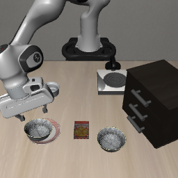
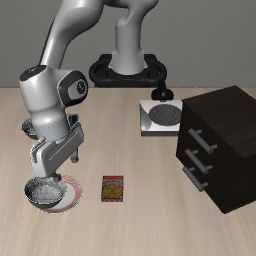

# OpenVLA语言扰动诊断v1：完整结果

2026-10-11，19:11（Asia/Shanghai）完成，进程退出码0；18条新rollout、4036次新策略调用，独立复核通过。六条N的841次旧调用核验复用、不重复计费。两次预检代码错误均发生在零策略查询时，原记录与运行器快照保留。本轮按[冻结入口](OPENVLA_LANGUAGE_ROBUSTNESS_V1_ENTRY_20261011.md)完成；正式事实冲突、训练、CAG和下一批确认没有启动。

**纯背景事实未稳定恢复正常成功率；简化相关事实仅在plate上有开发样本改善，整体A0门槛未通过。** 实验已按论文的语言扰动分层和选物／执行分离设计落实，这些是当前模型配置的探索结果。

## 1. 主表

OpenVLA原版Spatial FP4／SDPA，task1 ramekin与task8 plate各自原生场景，init0..2，同状态内部配对。原生相机、预处理、动作、种子、300步上限、3厘米On判据与提前终止保持；六个实际224输入图已逐幅审阅，plate init1目标左边缘部分裁剪的既有限制保留。

N为原命令，P为pick up→lift／place→put的等义改写；U0描述平坦桌面与灰色背景墙；A0重述直接next to关系并描述初始桌面支撑，去掉第二参照物比较。U0/A0事实前置、原问题收尾，与旧事实先行包装相同，各任务内分别52／50有效token，匹配旧U/A。P为31／29，N为32／30；全部无截断。

| 任务 | 条件 | 正确独占完成 | 正确双侧接触 | 无双侧接触的失败 | 正确接触／抬升后未完成 |
| --- | --- | ---: | ---: | ---: | ---: |
| ramekin | N（复用） | 3/3 | 3/3 | 0 | 0 |
| ramekin | P | 1/3 | 2/3 | 1 | 1 |
| ramekin | U0 | 2/3 | 2/3 | 1 | 0 |
| ramekin | A0 | 1/3 | 2/3 | 1 | 1 |
| plate | N（复用） | 2/3 | 2/3 | 1 | 0 |
| plate | P | 1/3 | 1/3 | 2 | 0 |
| plate | U0 | 1/3 | 2/3 | 1 | 1 |
| plate | A0 | 2/3 | 2/3 | 1 | 0 |

所有新条件均未记录错误碗双侧接触或上盘子事件。18条新样本共8成功、10失败；失败分为7条无双侧接触、3条正确接触并抬升后放置超限，不能统一归为选错对象。接触只代表原生双侧指垫接触代理，不单独证明稳定抓握或语义理解。

## 2. 每个初始化

S为正确独占完成；C为正确接触并抬升后未完成；Z为无双侧接触的失败。括号为执行步数，失败均300步。

| 任务 | 条件 | init0 | init1 | init2 |
| --- | --- | --- | --- | --- |
| ramekin | N | S(114) | S(99) | S(116) |
| ramekin | P | S(111) | Z(300) | C(300) |
| ramekin | U0 | S(109) | Z(300) | S(140) |
| ramekin | A0 | C(300) | Z(300) | S(129) |
| plate | N | S(107) | S(105) | Z(300) |
| plate | P | Z(300) | S(106) | Z(300) |
| plate | U0 | C(300) | S(99) | Z(300) |
| plate | A0 | S(211) | S(131) | Z(300) |

双侧接触的时间不是实际操作起点：ramekin init2 U0第83步已抬升超过2厘米，双侧接触第122步才首次被记录，第140步完成。该代理不能直接等同于LIBERO-CF的任一夹爪接触率，也不能用“尚无双侧接触”断言机器人未操作目标。

## 3. 配对退化与历史参考

正数表示相对N退化，负数才表示改善；本表每项分母均3，不将两个不同场景混作同画面。

| 任务 | N−P成功率差 | N−U0成功率差 | N−A0成功率差 | N−P接触率差 | N−U0接触率差 | N−A0接触率差 |
| --- | ---: | ---: | ---: | ---: | ---: | ---: |
| ramekin | +66.7百分点 | +33.3百分点 | +66.7百分点 | +33.3百分点 | +33.3百分点 | +33.3百分点 |
| plate | +33.3百分点 | +33.3百分点 | 0 | +33.3百分点 | 0 | 0 |

P只改轻量措辞就出现退化，支持当前配置存在更广的语言扰动敏感性，不能把问题限定为无关事实内容；P也有1 token长度变化，不提供纯词义效应的单因素证明。

旧前置U1只有两个init0：两者都成功；新U0的ramekin init0仍成功，plate init0却在正确接触／抬升后放置失败。去掉任务实体提及未稳定改善该控制；U0/U1同时改变内容，不能唯一归因于某个实体词。旧U的init1、2未补测。

旧事实先行A1三初始化各1/3。A0的ramekin仍1/3，成功初始化从0换到2；plate提高至2/3，新增init1成功。因此简化关系在一个任务上有局部改善，尚无一致的总体修复。ramekin A0低于2/3，整体探索正常门槛未通过，不能进入本载体的正式冲突解释。

## 4. 放置失败的具体后果

下列三条失败均有终点盘子接触、高度条件成立，但中心距超过原生3厘米阈值，原成功判据保留：

| 样本 | 最大抬升 | 终点中心距 | 原生结果 |
| --- | ---: | ---: | --- |
| ramekin init2 P | 14.17厘米 | 6.37厘米 | 未完成 |
| ramekin init0 A0 | 18.37厘米 | 3.21厘米 | 未完成 |
| plate init0 U0 | 8.15厘米 | 4.08厘米 | 未完成 |

plate init0 A0到第211步才成功，中心距2.94厘米；更早的180步尚未满足盘子接触／中心距条件。没有在中途因结果不利提前停止，也没有事后放宽阈值。

| ramekin init0 A0：中心距超限 | plate init0 U0：中心距超限 |
| --- | --- |
|  |  |

图像用于展示原生判据与物理终点；两幅来自不同任务，不构成跨场景因果对比。数值取自逐步仿真事件，手臂遮挡时不以图像代替接触判据。

## 5. 设计结论与边界

1. 保留原生N作为基线，继续分开报告等义P、背景U0、实体相关U1、直接关系A0及比较关系A1。这次分层揭示了不同失败阶段，比继续只寻找一个“可用无关句”提供了更具体的证据。
2. 正确接触／抬升与完整成功分别报告。plate U0与N的接触率相同，完成率降低；仅用SR容易把执行精度问题误当目标理解失败。
3. 正式事实冲突继续受能力与有效对照约束。A0本身是Q对象描述与初始支撑的重述，尚无独立对象身份锚；不能直接把其中next to改为far from就当有效X，因为改变描述后可能指向另一只同样在桌面上的碗，整句仍为真。后续X须另冻结唯一指代、反事实真值与两侧可执行目标。
4. 三个初始化和全部当前模板均是已见开发数据，不能当留出确认。模型为原版OpenVLA FP4；量化效应未隔离，结果不推广至OpenVLA-OFT、π0、π0.5或其他任务。

本轮完成后实验进程已退出。下一步优先依据这一分型冻结独立能力确认或更合适的任务／模型候选；不沿用本轮成功子集宣称已建立稳定事实冲突能力。CAG的接口限制见[官方代码核对](CAG_INTERFACE_CHECK_20261011.md)。

## 6. 成本、验证与资产

| 条件 | 新完整episode | 新策略调用 |
| --- | ---: | ---: |
| P | 6 | 1417 |
| U0 | 6 | 1248 |
| A0 | 6 | 1371 |
| 合计 | 18 | 4036 |

4036低于冻结上限5400；新策略诊断0、新中止策略调用0。六N的841次旧成本不重计；两次材质元数据预检错误各0策略调用，未充作失败rollout。按此前账本，OpenVLA累计已登记至少12323次、近期研究至少13553次；旧断电／Goal中止未知成本另列。

独立复核从完整保存轨迹重算原生On组件、成功与两碗事件，核对逐步动作／调用数、完整文本和初始像素／状态、停止时机、N来源链与校验值、代码／协议校验值、视频和18条完整样本。无额外模型查询。

资产：[完整精简结果](assets/phase1/openvla-language-robustness-v1-summary-20261011.json)、[独立复核](assets/phase1/openvla-language-robustness-v1-result-audit-20261011.json)、[manifest](assets/phase1/openvla-language-robustness-v1-manifest-20261011.json)、[零查询预检](assets/phase1/openvla-language-robustness-v1-preflight-20261011.json)、[六图审阅](assets/phase1/openvla-language-robustness-v1-visual-review-20261011.json)、[N复用核验](assets/phase1/openvla-language-robustness-v1-N-reuse-audit-20261011.json)、[查询账本](assets/phase1/openvla-language-robustness-v1-cost-ledger-20261011.json)、[历史30条轨迹重分析](LANGUAGE_ROBUSTNESS_HISTORY_20261011.md)。

完整动作、视频、逐步事件保留本地`outputs/openvla-spatial-4bit/language-robustness-v1-retry2-20261011/`；日志为`logs/openvla-language-robustness-v1-retry2-20261011.log`。运行与复核分别见[实验运行器](../scripts/check_openvla_language_robustness.py)和[独立审计脚本](../scripts/audit_language_robustness.py)。
