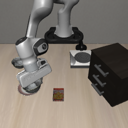
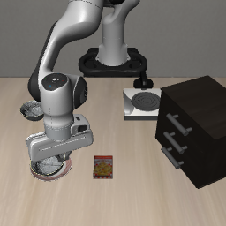
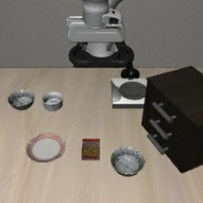
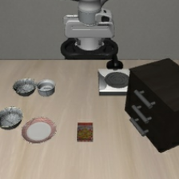
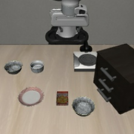
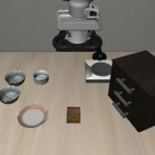
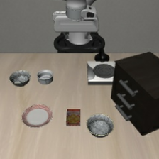
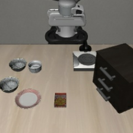

# OpenVLA早期事实撤除：未见初始化确认v1结果

2026-10-12，21:28（Asia/Shanghai）完成，进程退出码0。按[冻结入口](OPENVLA_TEMPORAL_CONFIRMATION_V1_ENTRY_20261012.md)执行18条新完整轨迹、3292次新策略调用；独立复核通过，实验进程已退出。

**固定第60次调用后撤除U0，在这六个此前未用于开发的初始化上，将正确独占完成从全程U0的3/6恢复到4/6，与原生N的逐初始化结果一致。** 恢复plate init5，未出现退化；三组保持成功，两组在N、U0和撤除下均失败。六组新U0与新撤除条件的前60次输入、执行动作和0..60步记录状态完全一致。这里的未见仅指本项目开发曝光，不声称未用于模型训练，也不代表新任务、模板或模型上的泛化。

## 1. 固定设置与主结果

Spatial task1 ramekin与task8 plate各使用自己的原生场景、init3／4／5。N为原指令；全程U0使用事实先行包装及真实背景句：`Initially, the table has a flat surface, and the wall in the background is gray.`；U0_early60的第1..60次调用同U0，第61次起仅输入N。切换时点与抓取、抬升和成功事件无关，没有在确认中调整。

沿用固定revision的OpenVLA原版Spatial FP4／SDPA、种子1、静置10步、单相机原生224预处理、每调用执行一步、300步上限。N／U0实际token为ramekin 32／52、plate 30／50，无截断。原生On(bowl1,plate)、中心XY距离小于3厘米及首次原生成功停止均保持；错误碗事件独立记录。全部18条从硬重置重新预测，未复用旧轨迹、重放动作或按N成功筛状态。

| 任务 | 条件 | 正确独占完成 | 正确双侧接触 | 正确碗抬升≥2厘米 | 错误双侧接触 |
| --- | --- | ---: | ---: | ---: | ---: |
| ramekin | N | 2/3 | 2/3 | 2/3 | 0/3 |
| ramekin | 全程U0 | 2/3 | 2/3 | 2/3 | 0/3 |
| ramekin | U0_early60 | 2/3 | 2/3 | 2/3 | 0/3 |
| plate | N | 2/3 | 2/3 | 2/3 | 0/3 |
| plate | 全程U0 | 1/3 | 2/3 | 2/3 | 0/3 |
| plate | U0_early60 | **2/3** | 2/3 | 2/3 | 0/3 |

18条中11条正确独占完成，7条失败：6条无双侧接触，1条正确接触／抬升后未满足放置判据。未出现错误碗双侧接触或上盘子事件。双侧指垫接触是原生抓取检查代理，不直接等同任一触碰、稳定抓握或语义理解。

## 2. 六个初始化完整保留

S为正确独占完成，C为正确接触／抬升后未完成，Z为无双侧接触的失败；括号为实际执行步数。

| 任务／初始化 | N | 全程U0 | U0_early60 | 撤除相对全程U0 |
| --- | --- | --- | --- | --- |
| ramekin init3 | Z(300) | Z(300) | Z(300) | 均失败 |
| ramekin init4 | S(142) | S(124) | S(124) | 均成功 |
| ramekin init5 | S(113) | S(94) | S(92) | 均成功 |
| plate init3 | S(116) | S(88) | S(87) | 均成功 |
| plate init4 | Z(300) | Z(300) | Z(300) | 均失败 |
| plate init5 | S(107) | C(300) | **S(105)** | **恢复** |

plate init5全程U0第76步记录正确双侧接触，第78步达到2厘米抬升，最大抬升13.86厘米。终点盘子接触与高度成立，但中心距4.532厘米，原生目标未成立。撤除条件第75步接触、第78步抬升达到2厘米，第105步正确完成，中心距1.163厘米；N第107步完成，中心距2.015厘米。撤除挽回的是正确目标的完整放置失败，没有观察到错误目标选择。

ramekin init3和plate init4的N、U0与撤除均未记录双侧接触或2厘米抬升，作为原有基线失败保留，不归为U0新增失败。ramekin init3两条U0前缀虽有0.918厘米最大高度变化，仍不能称完全没有物体运动。

| plate init5：全程U0未完成 | plate init5：撤除后完成 |
| --- | --- |
|  |  |

终点图有手臂遮挡，事件与中心距以原生仿真记录复核，图像不替代成功判据。

## 3. 前缀、阶段与独立性

六组均审计60次，合计360次前缀调用：每次实际输入审计（文本、token、图像）、执行动作、0..60步对象／机器人记录全部相同，最大动作差0，无首个分歧。所有撤除均实际触发，没有60次前成功或未触发案例；前缀由新预测产生。见[独立前缀审计](assets/phase1/openvla-temporal-confirmation-v1-prefix-audit-20261012.json)。

固定60次并不对应统一物理阶段。ramekin init5第58步已记录双侧接触、第59步抬升达到2厘米；plate init3第59步已接触、第63步才抬升达到2厘米。其余四组在前60步均未记录双侧接触或2厘米抬升。本轮不能统称抓取前撤除，也不能将恢复单独归因于放置阶段的某个动作。完整阶段记录见[零查询阶段审计](assets/phase1/openvla-temporal-confirmation-v1-stage-audit-20261012.json)。

查询前扫描537个历史JSON、核对56个原始状态哈希；六个候选身份无此前开发记录，六个实际重置哈希互异且不匹配历史。运行时重新核对全部历史文件SHA、模型／依赖／旧辅助代码和场景来源；旧开发轮仅作配置来源，不复用其N或U0对照。六幅实际224输入图逐幅审阅通过。plate init3／4／5目标在左缘部分裁剪但可辨认，限制如实保留，没有改预处理或排除状态。

| ramekin实际输入 | plate实际输入 |
| --- | --- |
|  |  |
|  |  |
|  |  |

## 4. 与开发结果的关系及边界

| 范围 | N | 全程U0 | U0_early60 | 恢复／退化 |
| --- | ---: | ---: | ---: | --- |
| [开发init0..2](OPENVLA_TEMPORAL_WITHDRAW_V1_RESULTS_20261011.md) | 5/6 | 3/6 | 5/6 | 2／0 |
| 本轮确认init3..5 | 4/6 | 3/6 | 4/6 | 1／0 |

本轮在新初始化上复现一条恢复，支持固定60次规则在当前模型、两任务和同一U0模板内的有限迁移。ramekin本轮全程U0与N成功／失败已一致，没有额外失败可恢复；两组共同基线失败也未被修复。小样本不支持普遍有效或显著性结论，完成步数差只作描述。

撤除同时改变后续事实内容、输入长度与包装，不能据此隔离纯事实语义效应，或推断注意力、记忆与图文主导机制。U0结果不替代A0一致事实资格，原A0整体门槛仍未通过，正式事实冲突新增0。本轮结束后未自动开展A0撤除、时点搜索、新模板／模型、训练或新的确认批次。

## 5. 成本与可核验证据

| 条件 | 新完整轨迹 | 新策略调用 |
| --- | ---: | ---: |
| N | 6 | 1078 |
| 全程U0 | 6 | 1206 |
| U0_early60 | 6 | 1008（U0前缀360／N后缀648） |
| 合计 | **18** | **3292** |

新诊断、技术中止、失败预检和旧轨迹复用均0；3292低于5400上限。OpenVLA已登记累计至少16513次，近期研究至少17743次，历史未知中止成本另列，不当作零。开发两轮与本轮确认共42条新完整轨迹、8226次新调用，保留各批独立口径。

独立审计逐条核验18条完整来源、冻结代码／配置／入口SHA、历史文件SHA、状态与实际输入、60／61边界、动作／查询／记录数、前缀相同、原生On组件与3厘米判据、首次成功停止、接触／抬升／失败分型、逐初始化结果、18段视频及调用成本，新增模型查询0。精简资产与本地来源按字节一致归档。

资产：[精简完整结果](assets/phase1/openvla-temporal-confirmation-v1-summary-20261012.json)、[独立结果审计](assets/phase1/openvla-temporal-confirmation-v1-result-audit-20261012.json)、[查询账本](assets/phase1/openvla-temporal-confirmation-v1-cost-ledger-20261012.json)、[manifest](assets/phase1/openvla-temporal-confirmation-v1-manifest-20261012.json)、[预检](assets/phase1/openvla-temporal-confirmation-v1-preflight-20261012.json)、[六图审阅](assets/phase1/openvla-temporal-confirmation-v1-visual-review-20261012.json)、[历史曝光清单](assets/phase1/openvla-temporal-confirmation-v1-seen-inventory-20261012.json)、[候选原始身份](assets/phase1/openvla-temporal-confirmation-v1-candidate-identities-20261012.json)、[运行时来源核对](assets/phase1/openvla-temporal-confirmation-v1-provenance-audit-20261012.json)。

完整逐步输入、动作、事件、18段视频和代码／协议快照保留在`outputs/openvla-spatial-4bit/temporal-confirmation-v1-20261012/`；日志为`logs/openvla-temporal-confirmation-v1-20261012.log`。运行器：[check_openvla_temporal_confirmation.py](../scripts/check_openvla_temporal_confirmation.py)，审计：[audit_temporal_confirmation.py](../scripts/audit_temporal_confirmation.py)，准备：[prepare_openvla_temporal_confirmation.py](../scripts/prepare_openvla_temporal_confirmation.py)。
