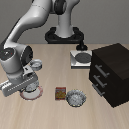
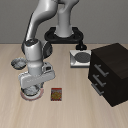
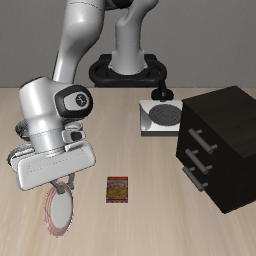

# OpenVLA早期事实撤除v1：完整结果

2026-10-11，20:15（Asia/Shanghai）完成，运行进程退出码0；6条新完整rollout、898次新策略调用，独立复核通过。六条N与六条全程U0核验复用，2089次旧调用不重复计费。按[冻结入口](OPENVLA_TEMPORAL_WITHDRAW_V1_ENTRY_20261011.md)运行，首次执行完成，无新增中止或额外策略诊断。

**在这六个开发状态下，第60次调用后撤除U0使正确独占完成从3/6恢复到5/6，与原指令N的逐初始化成功／失败一致。** 六条前60次实际输入、执行动作及0..60步记录状态均与旧全程U0完全相同。两条原U0失败恢复，原U0成功的三条均保留成功；plate init2在N、全程U0与撤除条件下都失败。这是当前模型与固定切换时点的开发结果，未开展留出确认。

## 1. 固定方法与主表

OpenVLA原版Spatial、固定checkpoint revision、FP4／SDPA，task1 ramekin与task8 plate各用自己的原生场景，init0..2，种子1、静置10步、单相机原生224预处理、每调用执行一步、300步上限。仍以原生On(bowl1,plate)、中心距小于3厘米和首次原生成功停止；错误碗事件单独记录。

U0_early60前1..60次调用使用原U0背景事实和fact-first包装，第61次起输入原生N。60提前固定为步数上限的前20%，没有按抓取或成功事件调整。原问题逐字保持，token从ramekin 52／plate 50恢复为32／30，无截断；不增加相机、本体信息、外部规划、缓存或动作混合。六条均从硬重置重新预测全程动作，没有重放旧前缀。

| 任务 | 条件 | 正确独占完成 | 正确双侧接触 | 错误碗双侧接触 |
| --- | --- | ---: | ---: | ---: |
| ramekin | N（复用） | 3/3 | 3/3 | 0/3 |
| ramekin | 全程U0（复用） | 2/3 | 2/3 | 0/3 |
| ramekin | U0_early60 | **3/3** | **3/3** | 0/3 |
| plate | N（复用） | 2/3 | 2/3 | 0/3 |
| plate | 全程U0（复用） | 1/3 | 2/3 | 0/3 |
| plate | U0_early60 | **2/3** | 2/3 | 0/3 |

每任务撤除条件较全程U0增加1/3完成；ramekin还增加1/3双侧接触，plate接触率不变。原生3厘米成功判据没有放宽。六图已逐幅审阅，初始实际像素与旧U0一致；plate init1目标在左缘部分裁剪的既有限制保留。

## 2. 每个初始化

S为正确独占完成，C为正确双侧接触／抬升后未完成，Z为无双侧接触的失败。括号为执行步数。

| 任务／初始化 | N | 全程U0 | U0_early60 | 撤除相对全程U0 |
| --- | --- | --- | --- | --- |
| ramekin init0 | S(114) | S(109) | S(112) | 保持成功 |
| ramekin init1 | S(99) | Z(300) | **S(150)** | 恢复成功 |
| ramekin init2 | S(116) | S(140) | S(125) | 保持成功 |
| plate init0 | S(107) | C(300) | **S(109)** | 恢复成功 |
| plate init1 | S(105) | S(99) | S(102) | 保持成功 |
| plate init2 | Z(300) | Z(300) | Z(300) | 仍失败 |

ramekin init1全程U0未记录双侧接触、最大抬升仅0.59厘米；撤除后第105步记录正确双侧接触，第108步抬升达到2厘米，第150步原生完成，中心距2.964厘米。其完成明显慢于N的99步，成功恢复不意味着轨迹或效率完全恢复。

plate init0全程U0第73步接触、第78步抬升达到2厘米，终点盘子接触／高度成立但中心距4.081厘米超限；撤除后第74步接触、第79步抬升达到2厘米，第109步完成，中心距0.604厘米。因此一个恢复涉及接触／搬运过程，另一个涉及已经接触正确目标后的完整放置，不能把全部退化统一归为选错对象。

plate init2三个条件均未记录两碗双侧接触或正确碗2厘米抬升，保持300步失败，不将这一原有基线失败归为新增语言干扰。新六条均未出现错误碗上盘子事件。

| ramekin init1：撤除后恢复 | plate init0：撤除后恢复 | plate init2：仍失败 |
| --- | --- | --- |
|  |  |  |

终点图可能被手臂遮挡，成功与接触按原生仿真事件复核，不能以图像代替判据。

## 3. 前缀一致性与解释

六条各60次，合计360次新预测的前缀审计全部一致：实际输入审计（含文本／token和处理后图像）、解码后执行动作、0..60步全部对象／机器人记录逐项相同；最大动作差为0，没有前缀分歧。独立审计从原始文件重新计算，见[前缀审计](assets/phase1/openvla-temporal-withdraw-v1-prefix-audit-20261011.json)。

旧全程U0的这六条在60步内都未记录双侧接触或超过2厘米抬升；新前缀相同。因此本轮是在早期接近目标之后撤除事实，不能称作抓取后撤除，也不能直接定位到单独的放置阶段。双侧代理不等同任一接触或稳定抓握：ramekin init2撤除条件第86步已抬升2厘米，第125步才记录双侧接触并完成。

结果支持：在相同早期历史下，恢复原生指令的后续闭环能够挽回这两个全程U0失败，早期扰动后的状态仍有恢复可能。撤除同时改变后续内容、长度与包装，尚不能隔离纯事实语义效应，也不提供内部注意力、记忆或图文主导机制的证据。

## 4. 后续使用边界

本轮仅一个U0模板、一个固定60次时点、两个不同原生场景和三个已见开发初始化；没有时点搜索或独立确认。下一步若验证这一缓解，宜冻结同一60次规则，在未见初始化配对N／全程U0／撤除三条件，完整保留N原有失败，不按新结果挑状态。

U0撤除恢复不能替代A0的一致事实资格；本轮没有运行A0撤除、X、同场景换目标、更换任务／模型、CAG或训练。既有A0整体门槛仍未通过，严格事实冲突与旧资格不改写。复核归档后本轮结束，没有自动启动新的实验批次。

## 5. 查询账本与复核资产

| 类别 | 新完整episode | 新策略调用 | 已计费来源调用 |
| --- | ---: | ---: | ---: |
| U0_early60，前60次U0 | 6条内的前缀 | 360 | 0 |
| U0_early60，后续N | 同6条的后缀 | 538 | 0 |
| 新完整rollout合计 | 6 | **898** | 0 |
| N来源核验复用 | 0 | 0 | 841 |
| 全程U0来源核验复用 | 0 | 0 | 1248 |

898低于1800上限；新策略诊断0、中止调用0、失败预检调用0。已登记OpenVLA累计至少13221次、近期研究至少14451次；历史未知中止成本仍单列，未视为零。

独立复核通过全部18条新／复用记录：代码／配置／协议SHA、来源链和初始状态／图像、每次真实文本阶段与第60／61次边界、完整动作／查询／事件数、前缀输入／动作／记录状态、原生On组件及3厘米判据、首次成功停止、逐初始化比较、视频与查询成本。无额外模型查询。

资产：[完整精简结果](assets/phase1/openvla-temporal-withdraw-v1-summary-20261011.json)、[独立结果审计](assets/phase1/openvla-temporal-withdraw-v1-result-audit-20261011.json)、[manifest](assets/phase1/openvla-temporal-withdraw-v1-manifest-20261011.json)、[预检](assets/phase1/openvla-temporal-withdraw-v1-preflight-20261011.json)、[六图审阅](assets/phase1/openvla-temporal-withdraw-v1-visual-review-20261011.json)、[N复用审计](assets/phase1/openvla-temporal-withdraw-v1-N-reuse-audit-20261011.json)、[U0复用审计](assets/phase1/openvla-temporal-withdraw-v1-U0-reuse-audit-20261011.json)、[查询账本](assets/phase1/openvla-temporal-withdraw-v1-cost-ledger-20261011.json)。

完整动作、逐步事件及六段视频保留在`outputs/openvla-spatial-4bit/temporal-withdraw-v1-20261011/`，日志`logs/openvla-temporal-withdraw-v1-20261011.log`。运行器：[check_openvla_temporal_withdraw.py](../scripts/check_openvla_temporal_withdraw.py)，独立审计：[audit_temporal_withdraw.py](../scripts/audit_temporal_withdraw.py)。
